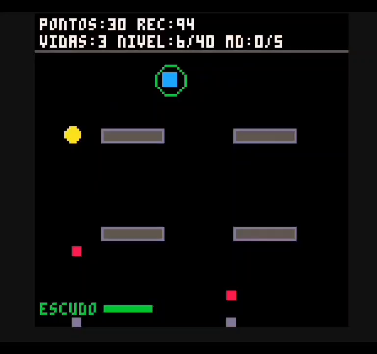

# Neon Rush: Sobrevivente

Jogo de sobrevivência desenvolvido em Lua utilizando o PICO-8. O objetivo é sobreviver aos inimigos, coletar moedas e avançar pelos níveis até alcançar a vitória.

## Funcionalidades

- Sistema de níveis e progressão.
- Inimigos e sistema de combate com projéteis.
- Diferentes armas e disparos.
- Coleta de moedas e pontuação.
- Power-ups com efeitos variados.
- Sistema de dash e invulnerabilidade.
- Recordes salvos entre partidas.
- Tela de vitória e game over.

## Tecnologias utilizadas

- Lua
- PICO-8

## Como executar

1. Baixe o arquivo `neon-rush-sobrevivente.lua` deste repositório.
2. Abra o PICO-8 ou o PICO-8 Education Edition.
3. Carregue o código no ambiente e execute o jogo.

## Sobre o projeto

Este foi meu primeiro projeto utilizando Lua, desenvolvido como atividade acadêmica para praticar lógica de programação, colisões, movimentação, sistemas de pontuação e desenvolvimento de jogos.
